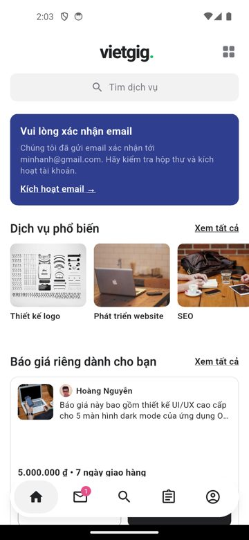
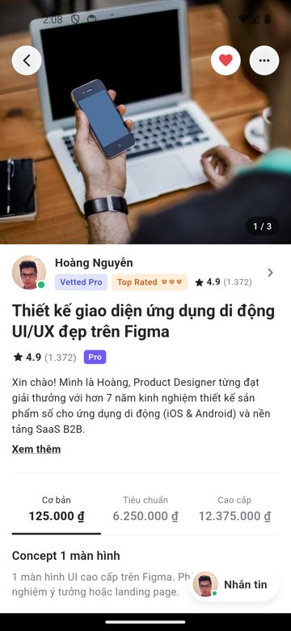
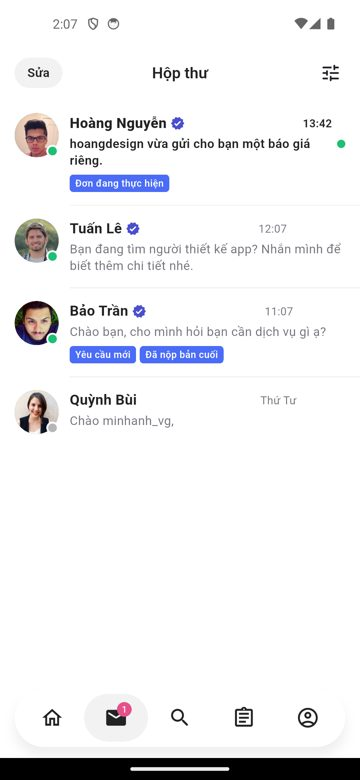
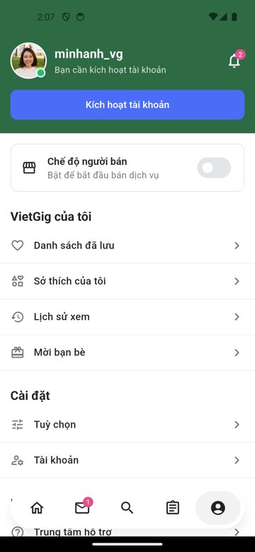
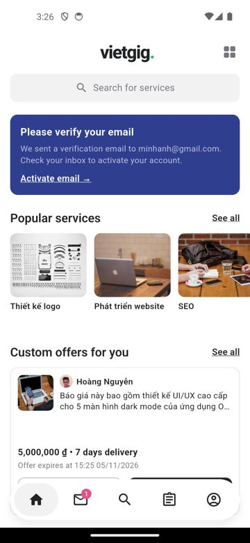
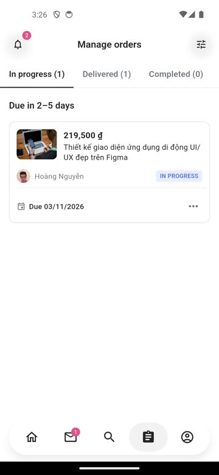

# VietGig – App chợ dịch vụ freelance (Flutter)

[](https://github.com/nguyenthean38/VietGig/actions/workflows/ci.yml)
  

Giao diện tiếng Việt & tiếng Anh, lấy cảm hứng từ bộ thiết kế mẫu (Mobbin). Hiện chạy bằng **dữ liệu mẫu (mock)**.

## Ảnh chụp màn hình

| Chào mừng | Trang chủ | Chi tiết dịch vụ | Hộp thư |
|:-:|:-:|:-:|:-:|
|  |  |  |  |

| Tài khoản | Home (English) | Orders (English) |
|:-:|:-:|:-:|
|  |  |  |

## Tính năng
- Đăng ký / đăng nhập, khảo sát ban đầu, chế độ khách
- Tìm kiếm & bộ lọc (giá, cấp người bán, thời gian giao), danh mục, sở thích
- Chi tiết dịch vụ 3 gói giá, hồ sơ người bán, đánh giá, portfolio, danh sách đã lưu
- Đặt hàng: dịch vụ thêm, thanh toán, gửi yêu cầu, theo dõi tiến độ, duyệt bản giao, đánh giá & tip, trung tâm giải quyết
- Hộp thư & chat: nhãn, lưu trữ, báo giá riêng theo cột mốc, trả lời nhanh, chuyển tiếp
- Chế độ người bán: bảng điều khiển, thu nhập (biểu đồ), cấp độ, lịch nghỉ, brief, mẫu báo giá
- Giao diện sáng / tối / theo hệ thống, tiếng Việt / English

## Chạy app
```
cd D:\CV\viet_gig
flutter pub get
flutter run            # chọn máy ảo Android / Chrome
```
Hoặc mở thư mục `android/` bằng Android Studio rồi bấm Run.

Tài khoản dùng thử: **minhanh@gmail.com / Matkhau1** (hoặc bấm "Bỏ qua" để xem với tư cách khách).

## Test
```
flutter analyze
flutter test
```

## Kiến trúc
- Material 3 + `ThemeExtension` (`AppTokens`) cho design token, sáng/tối.
- Đa ngôn ngữ chuẩn `gen-l10n` (.arb), ~1.450 chuỗi vi/en.
- `provider` + `go_router`, repository pattern (mock → Firebase).
- 125 test (unit + widget), CI GitHub Actions.

## Tài liệu
- `docs/DEV_GUIDE.md` – cấu trúc code, quy ước.
- `docs/FIREBASE.md` – các bước nối Firebase.
